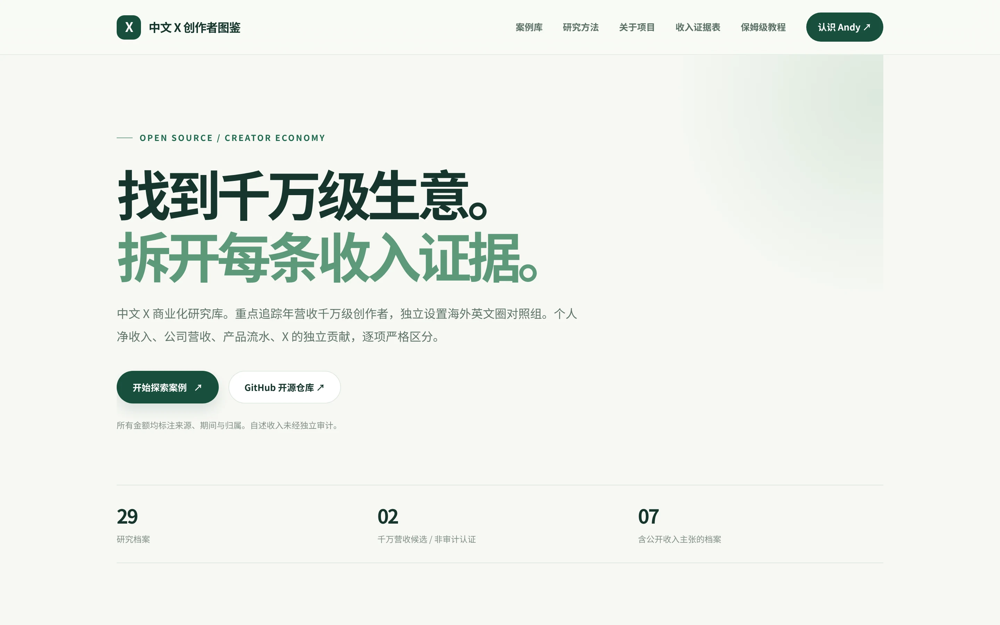

<div align="center">

# 📊 中文 X 千万级商业化研究库

**Chinese X Creator Income Handbook · 开源、可核查、持续维护**

> 研究千万级商业模式，拆解真实收入来源。每个数字都有出处，每一个不确定性都有标注。

[](LICENSE)
[](https://github.com/AIPMAndy/chinese-x-creators/stargazers)
[](https://github.com/AIPMAndy/chinese-x-creators/commits/main)
[](https://github.com/AIPMAndy/chinese-x-creators/actions/workflows/validate.yml)
[](https://github.com/AIPMAndy/chinese-x-creators/actions/workflows/deploy-pages.yml)


[**🌐 在线研究网站**](https://aipmandy.github.io/chinese-x-creators/) · [🔎 千万级调查线索](https://aipmandy.github.io/chinese-x-creators/investigations.html) · [🧾 收入证据账本](https://aipmandy.github.io/chinese-x-creators/evidence.html) · [⚖️ 双人对比](https://aipmandy.github.io/chinese-x-creators/compare.html) · [ℹ️ 关于项目](docs/about.html) · [📖 X 赚钱保姆级指南](https://github.com/AIPMAndy/x-income-handbook) · [🌱 Andy 官网](https://metaver.vip/) · [💬 服务与微信联系](https://metaver.vip/services)

</div>

## 👀 效果预览

<div align="center">

<a href="https://aipmandy.github.io/chinese-x-creators/"></a>

<sub>点击图片打开在线版 · <a href="https://aipmandy.github.io/chinese-x-creators/">aipmandy.github.io/chinese-x-creators</a></sub>

</div>

**研究状态：2026-10-31** · **29 位创作者与受访者** · **2 位千万级候选** · **13 条结构化收入主张** · **0 位经过独立验证的个人年净收入千万创作者**。

> ⚠️ **重要说明**：千万候选中的“千万”可能是**公司的历史年度营收**、**采访标题**或**产品业务收入**，目前都不代表 X 平台直接带来的个人税后净利润。不要把本研究当作收益排行榜、财务审计结果或盈利保证。

## V4 · 新的千万级线索调查（2026-11-01）

本轮另外追踪 **3 项公开千万级相关主张**，其中 Michael Guan 的 X 身份已确认但营收为 ARR 且主要在英语市场；HiWaifu 创始人公布了 2024 年营收但 X 身份未核；Jacky Chou 是已收录的海外对照，新增原始官网核查。**这三条是调查线索，不计入正式 29 位中文 X 创作者主榜，也不与已有 13 条收入主张叠加。**

- [🔎 研究调查页面](https://aipmandy.github.io/chinese-x-creators/investigations.html) · [结构化数据](data/investigation_leads.json)
- [证据及问题日志](research/investigation-log-2026-11-01.md)：归属主体、ARR 与实收区别、独立来源和账号归因。
- `scripts/validate_research.py` 对调查线索执行自动结构及分类检查，严禁把没有 X 身份的公司业绩算作 X 运营收入。

## V3 · 研究工具与数据维护

- [收入证据账本](https://aipmandy.github.io/chinese-x-creators/evidence.html)：逐条展示公开收入主张，支持证据等级和收入类型筛选，每条标出来源、统计期间、收入主体与限制。
- [创作者双人对比](https://aipmandy.github.io/chinese-x-creators/compare.html)：比较定位、商业链路与证据等级，不做收入排名。
- [首页案例库](https://aipmandy.github.io/chinese-x-creators/)：手机可直接使用全部导航。
- 维护方法：修改 `data/creators.json` 或 `data/revenue_claims.json` 后运行 `python3 scripts/build.py` 和 `python3 scripts/build_cases.py`，提交生成的 `docs/` 文件。

## 🔥 一、优先研究的高营收候选

| 对象 | 公开描述 | 判断 | 来源 |
|---|---|---|---|
| [刘小排 @bourneliu66](cases/bourneliu66.md) | 2025 年视频标题“年营收超千万”；另有本人采访被引述为“2024 年接近千万” | **千万经营规模候选**，表述冲突，缺少独立财务证明 | [访谈视频](https://www.bilibili.com/video/BV1WuQJYFEPr/) / [InfoQ](https://www.infoq.cn/article/07MyWmhiocSah2m9EqOt) |
| [Eric 出海 @utoolai](cases/utoolai.md) | X 主页发帖自述“曾年营收过千万” | **历史公司营收自述**，无具体年份，无法归因 X | [公开帖缓存](https://teapawt.net/utoolai) |

**海外英文区对照组（独立于中文主榜）：** [Jacky Chou @indexsy](cases/indexsy.md) 自述 2025 年业务组合营收约 **292 万美元**；[Damon Chen @damonchen](cases/damonchen.md) 在 2023 年访谈披露两款产品约 **130 万美元 ARR**。前者是自然年公司营收自述，TrustMRR 仅核验其中部分产品的独立流水；后者是时点年化收入指标（ARR），不等于当年真实入账。两人的公开内容主要面向英文市场，因此只作为商业模式与研究方法对照。

**目前未找到足以证明“中文 X 创作者本人在某个完整年度净赚 1,000 万元以上，且收入主要来自 X”的独立可核验证据。** 这一事实限制是项目研究结论，而非否定任何人的商业成就。

更完整的疑点、追访问题和补证计划见 [千万级候选研究清单](research/ten-million-watchlist.md)。

## 💰 二、已经有收入线索的可复盘案例

| 案例 | 金额 / 周期 | 口径 | 研究意义 |
|---|---|---|---|
| [看不懂的 SOL](cases/dtdt666.md) | 自述 **2025 年约 200 万元** | 广告与返佣，非净利润 | 垂直内容商业化，重点关注利益冲突及合规 |
| [泊舟](cases/bozhou-ai.md) | 自述 **2026 年截至 10 月约 104 万元** | 多渠道收入，**包含工资** | 用户信任、品牌商单与自有工具 |
| [鱼总聊 AI](cases/ai-jasonyu.md) | 自述 **约 12 个月 X 相关变现超 40 万元** | 商单、联盟等多渠道 | X 教程起号、商业转化与自然流量 |
| [余温 @gkxspace](cases/gkxspace.md) | 自述 **近一年 X 直接和间接变现超 50 万元** | 非自然年净利润 | 中文 X 内容如何转化为咨询、商单、社群和客户 |
| [Jason Zhu](cases/gosailglobal.md) | 访谈自述 **公司账户累计收入约 60 万元** | 非完整自然年，非个人净利润 | AI MCN、商单和内容获客 |
| [James](cases/go-indie-james.md) | 访谈自述 **2024 年业务超过 200 万元** | X 账号尚未确认 | 定价、产品商业化，未列入 X 账号排行 |

其他账号包括哥飞、sitin、熠辉、邵艾伦、宝玉、歸藏、李继刚等。**没有可靠年度收入数字的只做业务模式研究**。完整列表见 [`data/creators.json`](data/creators.json)。

## 🧪 三、研究模型

每位创作者统一拆成：

1. **人物/账号身份**：姓名、公开账号、创业历史，谨慎处理同名与身份对齐。
2. **收入事实**：金额、币种、期间、归属主体、收入类型、本人原话与证据等级。
3. **商业路径**：真实流量来源、产品交付、定价结构、主要客户与成本。
4. **X 归因**：是否有 UTM、推荐码或可被佐证的直接成交数据。
5. **可复现步骤**：需求验证、内容模板、成交动作、交付和复购。
6. **反例与不确定性**：媒体误传、利润缺失、年化误用、平台风险。

证据分级、冲突规则与准入条件见 [方法论](methodology/evidence-standard.md)。所有收入主张的原始结构化记录见 [`data/revenue_claims.json`](data/revenue_claims.json)，站点还提供 [创作者总表 CSV](docs/data/claims.csv) 和 [逐条收入主张 CSV](docs/data/revenue_claims.csv)。

## ✨ 四、网站功能

- 创作者名称、X Handle、业务关键词搜索
- 按垂类、**千万候选 / 百万实战 / 海外对照 / 研究观察**、证据等级筛选
- 独立档案页面（不靠推断显示收入）
- 公开证据、统计期间、平台贡献与风险揭示
- 可下载 CSV，GitHub Issue 提名 / 纠错
- 无外部数据库，无登录，无追踪；基于 Python 标准库构建静态站点
- 移动端、桌面端兼容；SEO/OG/Schema.org 与 sitemap

## 🚀 五、快速运行

需要 Python 3.9+，不需要 npm / API Key / 数据库。

```bash
python3 scripts/validate_research.py
python3 scripts/build.py
python3 scripts/build_cases.py
python3 -m unittest discover -s tests -v
python3 -m http.server 8080 --directory docs
```

浏览 `http://localhost:8080`。

## 🧱 技术栈

| 部分 | 说明 |
|---|---|
| 数据 | `data/*.json` 结构化档案与收入主张，导出 CSV |
| 构建 | Python 标准库脚本（`scripts/build.py`、`build_cases.py`），生成静态站点到 `docs/` |
| 校验 | `scripts/validate_research.py` + Python unittest（含站内链接检查） |
| 前端 | 原生 HTML / CSS / JavaScript，无外部数据库、无登录、无追踪 |
| 部署 | GitHub Actions + GitHub Pages |

> 🛠️ 网站打不开怎么办、如何发布仓库：见 [维护手册 docs/MAINTAINING.md](docs/MAINTAINING.md)。

## 🔁 六、怎么长期维护

- 每周一通过 [GitHub Actions](.github/workflows/weekly-research.yml) 自动创建复核 Issue（需仓库 Actions/Issue 写权限）；该 Issue 是检查清单，不是自动爬虫或自动事实认证。
- 按 [研究流水线](research/research-pipeline.md) 采集和核验新线索。
- 作者、研究者可使用 [千万级提名 Issue](.github/ISSUE_TEMPLATE/ten-million-lead.md) 提交材料。
- 每次修改数据之后运行构建、验证与 CI；来源更新应保留 Git 历史。
- 收入纠错时优先记录原文、冲突与撤回时间，不擅自篡改历史声称。

## ⚖️ 七、伦理、版权与商业关系

本项目只整理公开材料和独立原创分析，不复制博主全文、私下收入截图或未经授权肖像。引用和链接不意味着创作者本人认可本项目。Web3 项目及佣金推广涉及风险和合规义务，不构成投资或监管建议。

X 原 Creator Revenue Sharing 已在 2026 年 9 月停止，当前规则以 [Original Content Rewards 官方说明](https://help.x.com/en/using-x/original-content-rewards) 为准，禁止刷量、洗稿与伪造互动。

项目由 [AI 酋长 Andy](https://metaver.vip/) 维护。若需要 AI 产品化、个人 AI+IP、求职辅导或企业获客服务，可从 [官网服务页](https://metaver.vip/services) 联系与获取微信方式。咨询服务与所研究对象无商业背书关系。

## 📄 License

原创源码与原创研究文本遵循 [MIT License](LICENSE)。第三方内容、商标、截图、人物肖像不在本项目许可范围内。

---

## 👤 作者

<div align="center">

**AI 酋长 Andy** · 星觉科技

前腾讯/百度 AI 产品负责人 → 大模型公司 VP → AI 创业者

[](https://github.com/AIPMAndy)
[](https://x.com/AIPMAndy)

[](https://metaver.vip/)

觉得有用，欢迎点个 ⭐ Star，也欢迎提 Issue / PR 一起改进。

</div>
